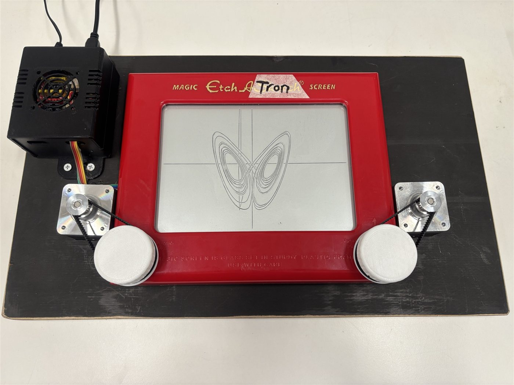

# Etchatron: setting it up and running it

A motorised Etch A Sketch that draws strange attractors. A web page on your
computer works out the attractor and plays its sound; an Arduino Uno under
the black cover turns the two knobs.

If you use Claude Code, you can hand it [CLAUDE_INSTALL.md](CLAUDE_INSTALL.md)
instead and it will do the software steps below for you.

Source and updates: https://github.com/sui001/etchatron



## What's in the box

| Part | Notes |
|---|---|
| Arduino Uno + Protoneer CNC Shield V3 | Under the black fan cover. Already flashed with the Etchatron controller firmware (v0.2.0), so it is ready to use |
| 2 x BTT TMC2209 stepper drivers | On the shield, X and Y slots. All three microstep jumpers under each are fitted (1/16 step). Leave them as they are. Current set to **Vref 0.8 V** (see below) |
| 2 x NEMA17 motors (Creality 42-40, about 1 A) | 20-tooth GT2 pulleys, belts to a 60-tooth pulley pushed over each Etch A Sketch knob (3:1) |
| Left knob = X (horizontal), right knob = Y (vertical) | |
| USB cable | Uno to your computer |
| 12 V supply, at least 2 A | Plugs into the Uno's barrel jack |

**Power.** The 12 V supply plugs into the Uno's round barrel jack. Two wires
soldered to the jack's own pins carry the same 12 V on to the shield's blue
screw terminals for the motors, so one plug powers everything. USB at the
same time is fine and is how the page talks to the Uno.

- Use a centre-positive 12 V supply of 2 A or more. A reversed supply will
  destroy the stepper drivers (the bypass goes around the Uno's protection).
- Do not plug or unplug the motor cables while the 12 V is on.

**Motor current.** Each driver's current is set by its small potentiometer:
**Vref 0.8 V** (about 0.57 A RMS; on these BTT drivers I_RMS ≈ Vref / 1.41).
Set 25 Nov 2026; the motors run only slightly warm. New drivers come at about
1.2 V, which makes these motors hot, so set any replacement driver to 0.8 V:
12 V and USB on, multimeter black probe on the shield's GND, red probe on the
pot's metal top, turn the pot an eighth of a turn at a time. If a drawing
skips steps, go up to 0.9-1.0 V; don't go past about 1.1 V.
The third jumper keeps the motors at full current whenever they are on, even
standing still, so switch them off (**Motors on/off**) between drawings.
- If the motors don't hold when switched on, check first that the barrel plug
  hasn't fallen out.

## Software you need

- **Chrome or Edge** (the page uses Web Serial, which Safari and Firefox lack).
- **Python 3**, only to serve the page locally (Web Serial only works from
  `localhost`, not from a file you double-click).
  Windows: https://www.python.org/downloads/ (tick "Add python.exe to PATH").
  macOS: `python3` is usually already there.
- **Arduino IDE 2**, only if you ever need to reflash the Uno:
  https://www.arduino.cc/en/software

## Running it

1. Plug in the 12 V supply and the USB cable.
2. Open a terminal **in this folder** (the one with this file) and run:

   ```
   python -m http.server 8000
   ```

   (on macOS: `python3 -m http.server 8000`). Leave it running.
3. In Chrome or Edge open **http://localhost:8000/control/** (keep the slash at the end).
   The version is shown next to the title and in the bottom-right corner
   (with the package's `VERSION`). If a yellow bar says the page has been
   updated, click it to reload.
4. Click **Connect Uno** and pick the Arduino Uno from the list
   (Windows: a COM port; macOS: `cu.usbmodem...`). The log shows
   `=== Etchatron controller v0.2.0 ===`. A line `noise 3 X - Y -` is
   normal with these jumpers.
5. Under **Output**, **Etch A Sketch, Uno on this computer** turns active once
   connected. It is the only output.
6. The motors start **off**. Turn the knobs by hand so the stylus is in the
   middle of the screen, then click **Zero here**.
7. Clear the screen, pick an attractor and click **Draw on Etch A Sketch**. The motors switch on
   by themselves.
8. **STOP** (top right) halts at once. **Pause** holds the drawing. **Motors on/off**
   lets you turn the knobs by hand again.

Try **Simulate machine** first if you want to see a drawing with nothing plugged in.
**Play on screen** is the original lorenz_av.py piece: screen and sound only.

## Settings (right-hand panel)

| Setting | Default | Meaning |
|---|---|---|
| Scale, knob ° per unit | 20 | Size of the drawing. 20 fills about three quarters of the screen height with the Lorenz butterfly |
| Speed, knob °/s | 60 | Drawing speed |
| Slack X / Y, ° | 23 / 17 | Backlash in the Etch A Sketch's strings, taken up on every reversal. Measured on this unit with `spiral/` |
| Blend | 3 | How gradually that slack is taken up (0 = all at once, leaves notches) |
| Limit ± knob ° | 550 | No point of a drawing goes further than this from the zero point. Parts outside are flattened against the box (dashed in the view) |
| Rotate drawing 90° | off | Lays tall figures along the wide side of the screen; then you can raise Scale to about 26-28 |

Click **Send to machine** after changing slack, blend or speed mid-session.

**Screen size, measured 25 Nov 2026:** about 1660 knob degrees wide by 1170
tall, so ±830 sideways and ±585 up and down from the centre. Limit is one
number for both directions, so the vertical sets it. If your stylus was not
quite centred, a drawing may touch one edge: re-centre and Zero again.

To measure it yourself: Zero in the centre, **Motors on**, then use the **Jog**
arrows (90° steps, then 20° near the edge) out to each edge, counting the
degrees, and **◎** to come back. Stop just short of the edge: at the edge the
knob turns but the stylus doesn't, and the page loses track of it.

## Other pages

- http://localhost:8000/views/ : one attractor as four live views (top, front, side, 3D).
- http://localhost:8000/timeline/ : sixteen attractors from Ptolemy's epicycles to Lorenz and after.
  The same sixteen can be drawn from the control page (**Timeline** set).

## Reflashing the Uno (only if needed)

The Uno already has the controller on it. To reload it, or after flashing
something else:

1. Open `controller/controller.ino` in Arduino IDE 2.
2. Board: **Arduino Uno**; Port: the Uno's port.
3. Click **Upload**. It needs no extra libraries.
4. Open the Serial Monitor at 115200 baud: it prints
   `=== Etchatron controller v0.2.0 ===`. Close the monitor before using the page
   (only one program can hold the port).

`lorenz/lorenz.ino` is a stand-alone alternative that draws the Lorenz
attractor with no computer at all (start the stylus in the centre, power on).
Reflash `controller/` to go back to the page.

## Troubleshooting

| Symptom | Check |
|---|---|
| Connect Uno shows no ports | USB cable (some are charge-only); close Arduino IDE's Serial Monitor |
| "Web Serial not available" | Use Chrome or Edge, and open `http://localhost:8000/control/`, not the file |
| Page loads but attractor list is empty / errors about `timeline.js` | The server was started inside `control/`. Start it in the top folder |
| Motors don't hold when on | 12 V barrel plug out, or supply off, or under 2 A |
| One axis weak or missing steps | Supply current limit too low (needs 2 A+); or that driver's Vref below 0.8 V |
| Motors hot (too hot to keep a finger on) | Vref too high: set 0.8 V. Motors left on between drawings |
| Drawing drifts or runs into an edge | Stylus was not centred at Zero; re-centre by hand with motors off, Zero here |
| Notches or flats where lines reverse | Slack settings; see `spiral/` for the test that set them |
