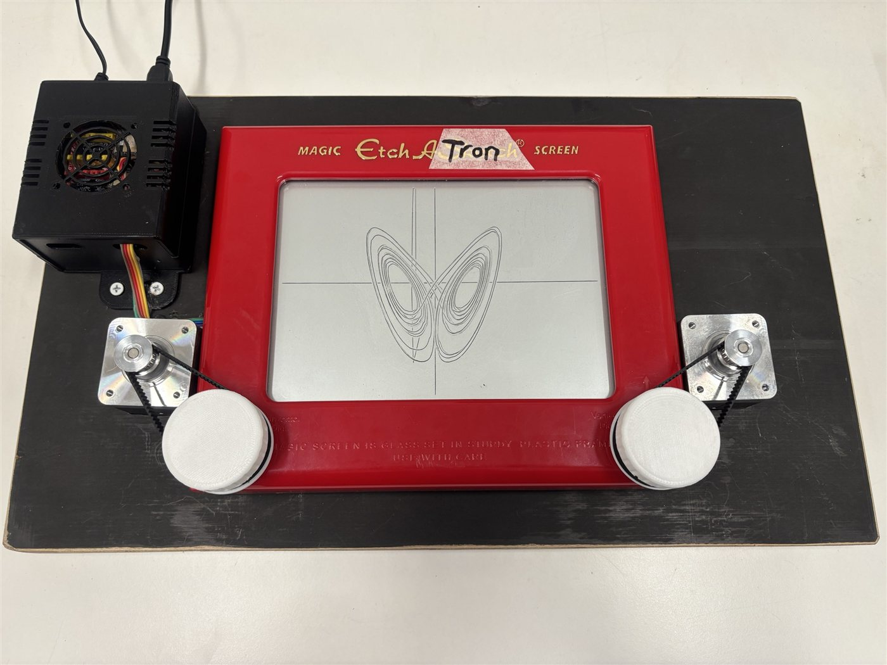

# Etchatron

A motorised Etch A Sketch that draws strange attractors, made for
Prof. Thomas Fischer (SUSTech). Two steppers turn the knobs through GT2 belts.



*The Lorenz attractor at scale 20, drawn from the control page (25 Nov 2026). The crosshair is the jog test that measured the screen's travel.*

Setting it up on a new computer: [INSTALL.md](INSTALL.md) (people) and [CLAUDE_INSTALL.md](CLAUDE_INSTALL.md) (for Claude Code).

| Path | What it is |
|---|---|
| `control/index.html` | Control page: Prof. Fischer's five attractors with sound and afterglow, drawn on the Etch A Sketch through the Uno over Web Serial |
| `control/fischer/lorenz_av.py` | Prof. Fischer's original audiovisual Lorenz script, kept verbatim as the reference for the port |
| `views/index.html` | Views page: one of the same five attractors as four live screens, looking down x, y and z plus an orthogonal 3D view you drag to turn. Screens only, no sound or machine output. `python -m http.server 8000 --directory views` |
| `timeline/index.html` | Attractor timeline: 16 entries from Ptolemy's epicycles (about 150 CE) through the pendulum, Watt's governor, van der Pol, Ashby's homeostat and Ueda to Lorenz and after, each live on the same four screens, in ink on paper. Every entry is tested for chaos and calibrated to Lorenz's speed. Screens only for now. Serve the repo root and open `/timeline/` |
| `controller/` | Uno firmware the control page talks to: queued absolute moves, blended slack take-up, position reports. Protocol in the file header |
| `spiral/` | Slack (backlash) test spiral with ring ladders for amount and blend speed; where X 23 / Y 17, blend 3 came from |
| `lorenz/` | Standalone Lorenz attractor sketch for an Uno + Protoneer CNC Shield V3 + TMC2209s (step/dir, replaces GRBL) |
| `grbl_setup.py` | Apply and read back the GRBL settings, for when the Uno runs GRBL 1.1h instead |
| `tools/etchatron_knob.py` | Knob and pulley generator: replacement knob, motor twin, and the over-knob 60T pulley that slots over the original knob. Writes to `knob/` |
| `tools/claims.py` | Geometry assertions the knob build has to pass (a copy of gen3d's) |
| `knob/` | Generated STLs, renders and `claims_*.json` |

Current drive: the over-knob 60T pulley on each original knob, driven by 20T
motor pulleys (3:1), 26.667 steps per knob degree. Measured screen travel (25 Nov 2026): about 1660 knob degrees wide by 1170 tall, so ±830 and ±585 from the centre; the page's Limit defaults to ±550.

Control page: flash `controller/`, then serve the repo root (Web Serial wants localhost, and the page loads `lib/timeline.js`):

```bash
python -m http.server 8000
```

then open http://localhost:8000/control/ in Chrome or Edge. Simulate machine runs it with nothing plugged in.

```bash
python tools/etchatron_knob.py --over-knob
python grbl_setup.py --port COM60 --show
```

The builder's own studio: the same page can also send drawings to piplot
plotters on a private network. Those outputs appear only with `?plotters` on
the URL, or when piplot serves the page (`control/deploy_to_plotterpi.sh`
puts it there).
